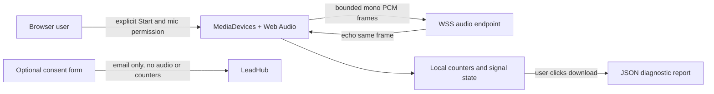

# Signal Room architecture

## Boundaries

- `frontend/src/App.jsx` owns the user session, browser capture, bounded frame sending, counters, recovery and local report download.
- `backend/` is a Spring WebSocket echo service with configured origin allowlist, frame/rolling-byte limits, and an instance connection cap. Origin restriction is not authentication.
- `frontend/src/diagnostic-report.js` creates a JSON report from counters only. It does not include audio, input-device identifiers, or microphone samples.
- The server does not play back, store, transcode, or persist received audio. Audio is transmitted only while the user starts a session.
- The optional LeadHub signup is separate from the audio path and requires consent plus an HTTPS service URL.

## ADR-001: retain an echo diagnostic, not a conferencing backend

**Decision:** Keep Signal Room as a single-path, bounded echo check and do not add recording or account storage.

**Reason:** The repository solves one testable developer problem with fewer data risks. The current backend has no user identity or production-grade authentication and must not be sold as a secure audio service.

**Trade-offs:** No multi-user rooms, durable telemetry, or cross-device history. The free hosted backend can sleep, and a local report cannot prove long-term service reliability.

**Release guard:** Use non-sensitive test audio only. Production claims require a managed host, authenticated sessions if private endpoints are supported, abuse and cost limits, uptime alerting, and a validated support policy.
